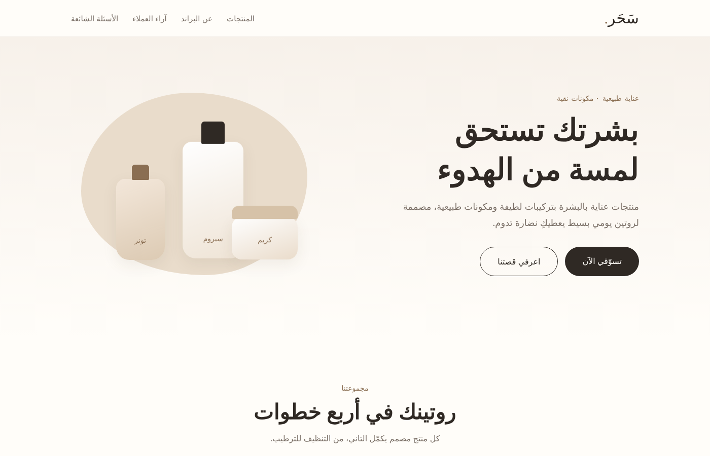

# Skincare Landing Page (Demo)

A responsive Arabic (RTL) landing page for a fictional skincare brand, built with plain HTML, CSS and JavaScript (no frameworks).

**Live demo:** https://saifaboalnaga.github.io/skincare-landing-demo/

## Features
- Minimalist beige and white design with elegant Arabic typography (Amiri + Tajawal)
- Sections: hero with CTA, products with prices, brand story, customer reviews, FAQ accordion, CTA banner, footer with social links
- Scroll reveal animations, hover effects, floating product illustrations
- Fully responsive (mobile, tablet, desktop) with a mobile menu
- Respects `prefers-reduced-motion`

The brand, products and reviews are placeholders for demonstration only.

Built by Saif Aboalnaga.
